# Agent (SQL) vs RAG (Document) — কীভাবে উত্তর আসে

> Beginner-friendly। এই প্রজেক্টে LLM **নিজে Database খোলে না**।  
> দুটো আলাদা রাস্তা আছে — ডায়াগ্রাম দেখেই বোঝা যাবে কোন প্রশ্নে কোন রাস্তা।

সম্পর্কিত: [architecture.md](architecture.md) · [erp-integration-plan.md](erp-integration-plan.md)

---

## ০. এক নজরে — কোন প্রশ্ন কোন রাস্তা?

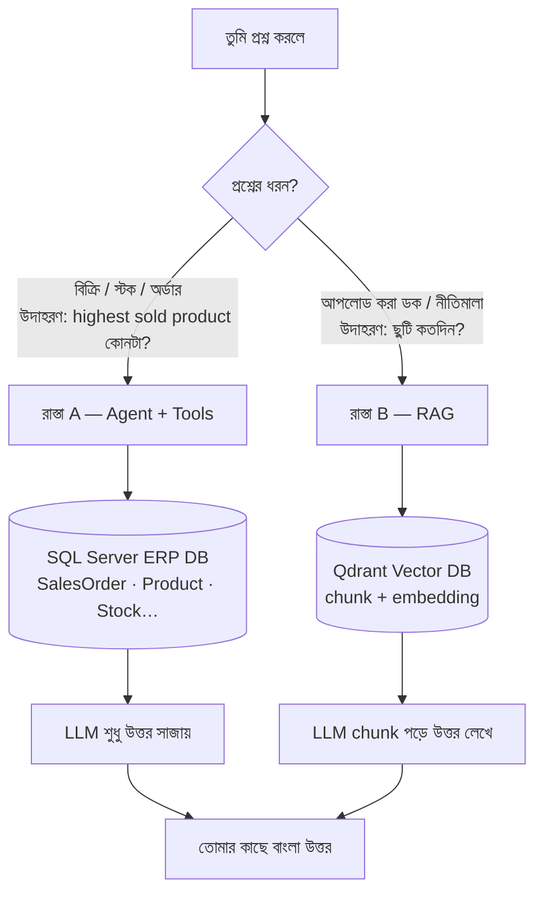

| | রাস্তা A — Agent | রাস্তা B — RAG |
|---|---|---|
| কখন | সংখ্যা, টেবিল, ERP | লেখা ডকুমেন্টের অর্থ |
| ডেটা কোথায় | SQL Server (`Erp` DB) | Qdrant (+ SQL-এ শুধু ফাইল মেটা) |
| LLM কী করে | কোন **টুল** ডাকবে ঠিক করে | আনা **chunk** পড়ে উত্তর লেখে |
| UI | Chat → **Agent mode ON** | **RAG** পেজ (বা RAG API) |
| API | `POST /api/v1/agent` | `POST /api/v1/rag` |

---

## ১. ভুল ধারণা ভাঙো (খুব জরুরি)

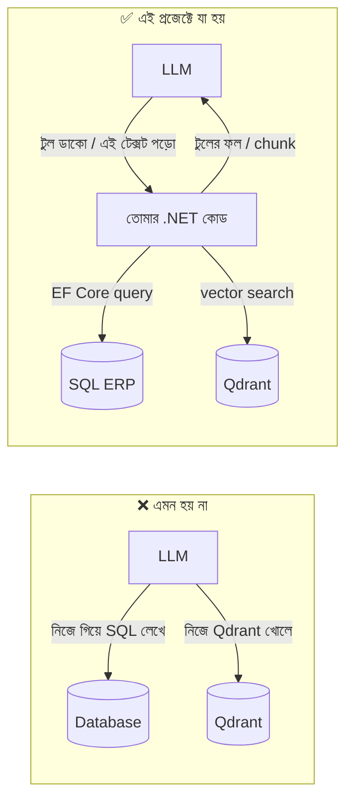

**মনে রাখো:** LLM = মগজ (বোঝা + বাক্য সাজানো)।  
**হাত** = Agent Tool কোড। **চশমা** = RAG-এ খুঁজে আনা টেক্সট।

---

# রাস্তা A — Agent + SQL (ERP প্রশ্ন)

উদাহরণ প্রশ্ন: **“highest sold product কোনটা দেখাও”**

## A1. পুরো যাত্রা (sequence)

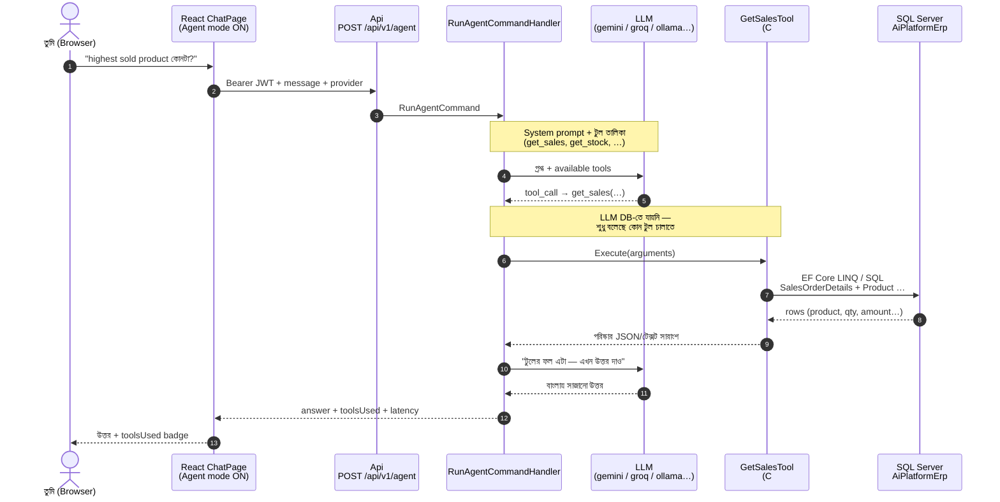

## A2. ভেতরে কী কী টুকরো জড়ো হয়

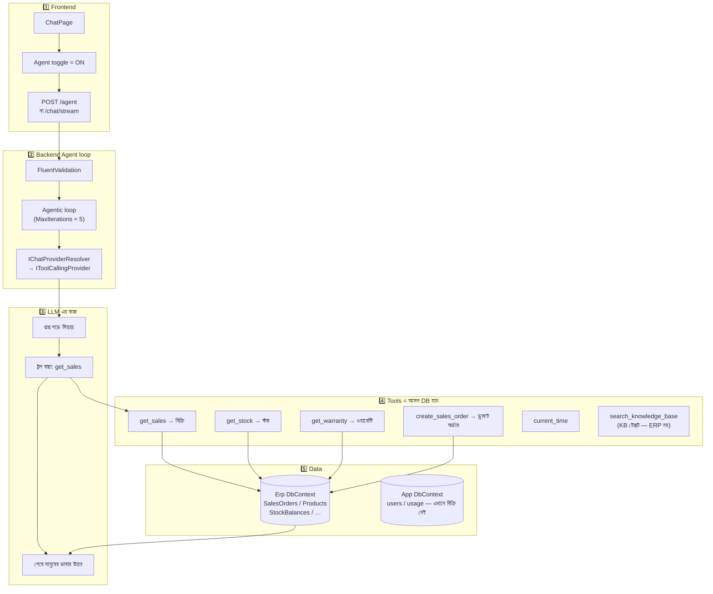

## A3. “jumbled objects” নিয়ে কী হয়?

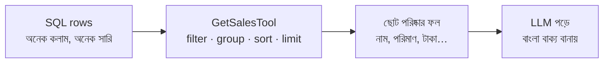

- কাঁচা পুরো টেবিল LLM-কে দেওয়া হয় **না**।
- টুলই হিসাব/ফিল্টার করে → LLM শুধু পড়ে ও বলে।

## A4. এই রাস্তায় Qdrant লাগে কি?

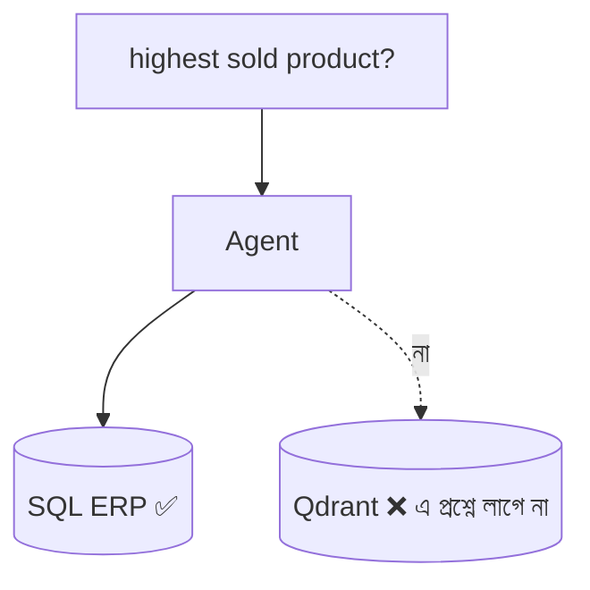

**না।** বিক্রি/স্টক = স্ট্রাকচার্ড টেবিল → SQL Tool। Vector search এখানে অপ্রয়োজনীয়।

---

# রাস্তা B — RAG (ডকুমেন্ট আপলোড + প্রশ্ন)

উদাহরণ: নীতিমালা `.txt` আপলোড → পরে জিজ্ঞাসা **“ছুটি কতদিন?”**

RAG = **R**etrieval **A**ugmented **G**eneration  
অর্থ: আগে খুঁজে টেক্সট আনো → পরে LLM দিয়ে উত্তর লেখো।

## B1. অংশ দুইটা — Upload আর Ask আলাদা সময়

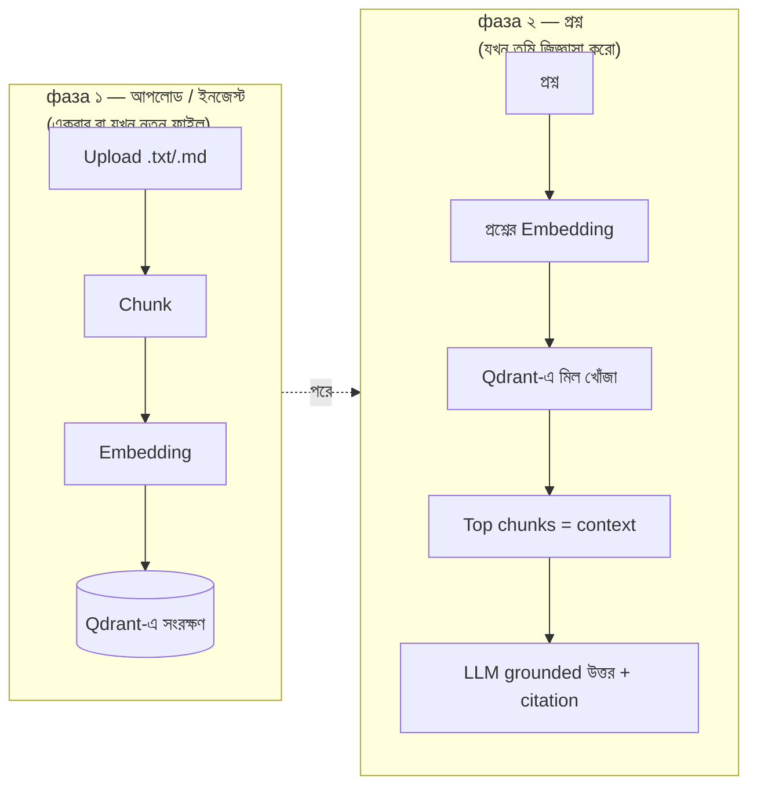

## B2. Upload → Ingestion (বিস্তারিত sequence)

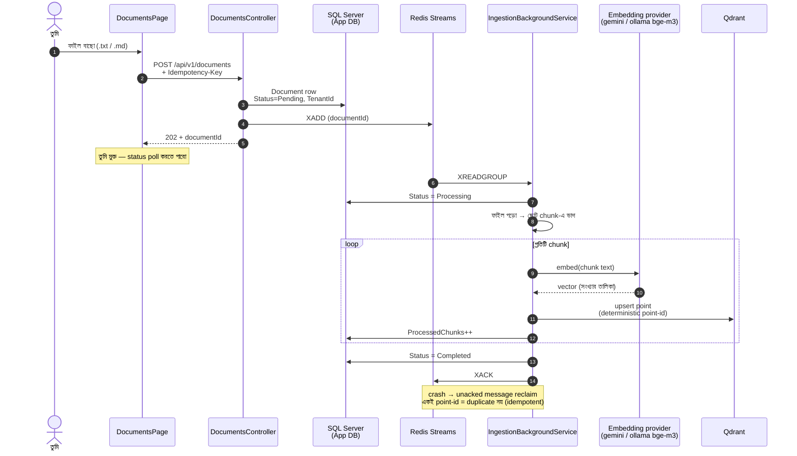

## B3. Upload এর পর ডেটা কোথায় থাকে?

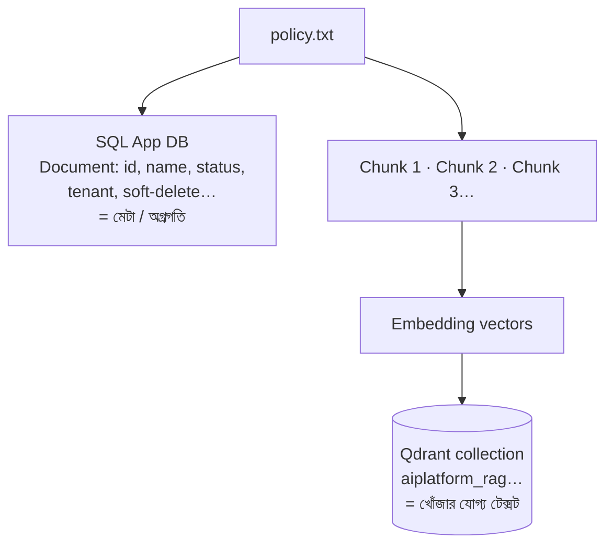

- **SQL** = ফাইলের রেকর্ড ও স্ট্যাটাস (বিক্রির হিসাব নয়)।
- **Qdrant** = অর্থ-মিলিয়ে খোঁজার জন্য ভেক্টর + chunk টেক্সট।

## B4. প্রশ্ন → উত্তর (RAG query sequence)

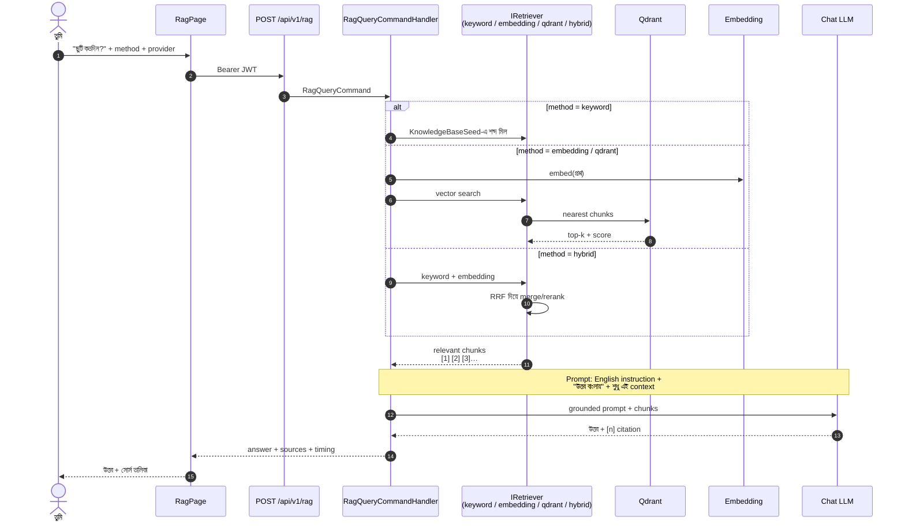

## B5. Embedding মানে কী? (সরল ছবি)

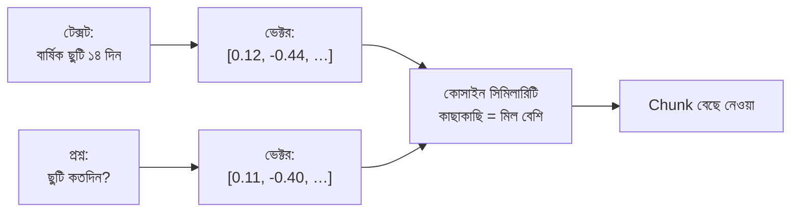

LLM এখানে SQL `SELECT` চালায় না — **অর্থের কাছাকাছি টেক্সট** আনে।

## B6. Hybrid method কী করে?

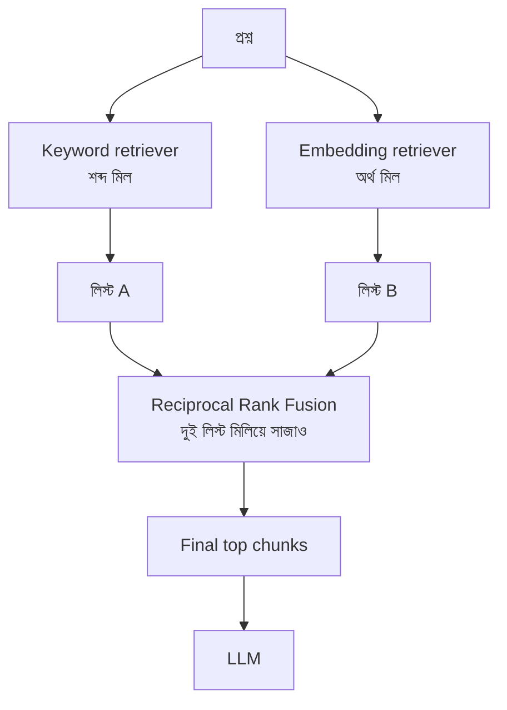

নোট: RRF কোনো model দিয়ে ডক “পড়ে” না — শুধু দুই র‍্যাঙ্ক লিস্ট মেশায়। (ভবিষ্যৎ cross-encoder reranker আলাদা জিনিস — TODO backlog।)

---

# পাশাপাশি তুলনা (এক পাতায়)

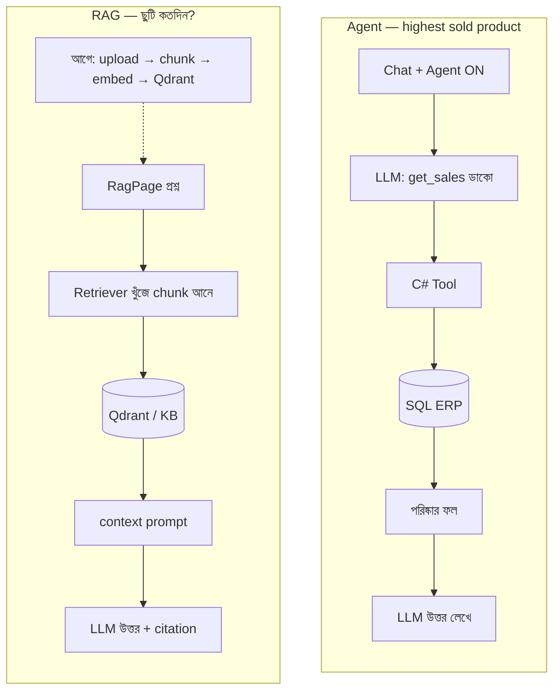

| প্রশ্ন | LLM কি DB টেবিলে যায়? | Vector DB? | মূল কম্পোনেন্ট |
|---|---|---|---|
| highest sold product | না — Tool যায় | না | `RunAgent` + `GetSalesTool` + `ErpDbContext` |
| ছুটি কতদিন (uploaded doc) | না | হ্যাঁ Qdrant | upload worker + `RagQuery` + retriever |
| সাধারণ গল্প/চাট | না | সাধারণত না | `POST /chat` বা `/chat/stream` (memory/cache থাকতে পারে) |

---

# কোড ম্যাপ (খুঁজতে গেলে)

| ধাপ | ফাইল / জায়গা |
|---|---|
| Agent API | `backend/src/Api/Controllers/AgentController.cs` |
| Agent loop | `backend/src/Application/Features/Agent/RunAgentCommandHandler.cs` |
| Sales tool | `backend/src/Infrastructure/Agent/GetSalesTool.cs` |
| Stock tool | `backend/src/Infrastructure/Agent/GetStockTool.cs` |
| ERP DB | `backend/src/Infrastructure/Persistence/` + `Domain/Entities/Erp/` |
| RAG API | `backend/src/Api/Controllers/RagController.cs` |
| RAG handler | `backend/src/Application/Features/Rag/RagQueryCommandHandler.cs` |
| Upload | `DocumentsController` + `UploadDocumentCommandHandler` |
| Ingestion queue | Redis Streams + `IngestionBackgroundService` |
| Vector store | `Infrastructure` Qdrant (`IVectorStore`) |
| Chat Agent UI | `frontend/src/features/chat/ChatPage.tsx` (agent toggle) |
| RAG UI | `frontend/src/features/rag/RagPage.tsx` |
| Docs UI | `frontend/src/features/documents/DocumentsPage.tsx` |

---

# নিজে হাতে দেখার ছোট চেকলিস্ট

1. **Agent/SQL:** Chat → Agent ON → “জুলাই ২০২৬-এর বিক্রি কত?” → উত্তরের নিচে `toolsUsed` (যেমন `get_sales`) দেখো।  
2. **RAG:** Documents-এ `samples/sample-kb-bn.txt` আপলোড → Completed হোক → RAG পেজে ছুটি/দাম জিজ্ঞাসা → citation/source দেখো।  
3. দুটো মিশিয়ে ভাবো না — **এক প্রশ্ন = এক রাস্তা**।

---

# টুল catalog (Tool RAG) — ডক collection থেকে আলাদা

টুলের `Description` **কোডে** থাকে (`Infrastructure/Agent/*Tool.cs`)।  
App start (+ প্রতি agent call) → name+description embed → Qdrant collection **`aiplatform_tools`** (docs-এর `aiplatform_rag` নয়)।

- টুল সংখ্যা ≤ `Agent:ToolTopK` → prompt-এ সব টুল (তবু sync হয়)।  
- টুল বেশি → প্রশ্ন দিয়ে top-k retrieve → শুধু সেগুলো LLM মেনুতে।  
- **নতুন টুল:** `ITool` ক্লাস + DI register + **restart** → অটো upsert। Doc upload লাগে না।

Config: `Agent:ToolRetrievalEnabled`, `ToolTopK`, `ToolsCollection`।

---

# এক লাইনের সারাংশ

> **সংখ্যা/অর্ডার/স্টক** → Agent টুল → **SQL ERP**।  
> **ডকুমেন্টের লেখা** → Upload+Embed → **Qdrant** → RAG → LLM।  
> **অনেক টুল** → descriptions → আলাদা Qdrant collection → top-k মেনু।  
> **LLM কখনো একা DB ব্রাউজ করে না** — অ্যাপ তাকে টুল বা context ধরিয়ে দেয়।
